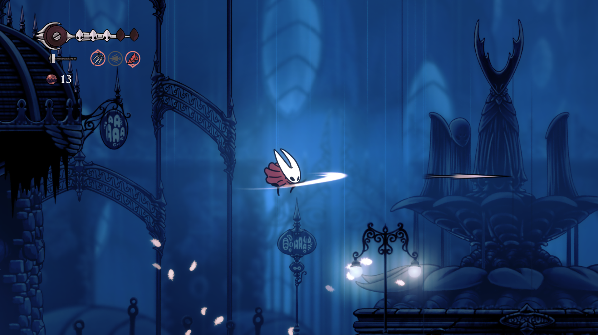

# Hornet in Hallownest

A Hollow Knight Mod, bringing Hornet as a playable character to the base game.



By Jakob Hellermann (`@dubi steinkek`) and Planet_Xplorer

## Status

Getting close to release 👀

Right now the mod is only playable on the latest Hollow Knight version (1.5.12620, released 2026) with this branch of the modding API: https://github.com/hk-modding/api/pull/164.
The download for the mod and the modding API can be found in the [releases tab](https://github.com/jakobhellermann/hkmod-HornetInHallownest/releases/latest).

Please check the existing [issues](https://github.com/jakobhellermann/hkmod-HornetInHallownest/issues) when reporting a bug.

> [!IMPORTANT]
> After installing the mod, you have to start the game *twice*.
> The first run will say `HornetInHallownest: Failed to initialize! Check ModLog.txt` in the mod menu.

The changelog can be found in [CHANGELOG.md](./CHANGELOG.md).

## Progression

Hornet earns her Silksong kit through Hollow Knight's progress. Progress made as either hero counts for both; masks,
mask shards and geo are shared outright.

<details>
<summary>What earns what (spoilers)</summary>

### Abilities

| Hollow Knight                                   | Hornet                                                      |
| ----------------------------------------------- | ----------------------------------------------------------- |
| Mothwing Cloak                                  | Swift Step                                                  |
| Mantis Claw                                     | Cling Grip                                                  |
| Monarch Wings                                   | Faydown Cloak and Drifter's Cloak                           |
| Crystal Heart                                   | Clawline; hold up + Clawline to fly like the Crystal Heart  |
| King's Brand                                    | Silk Soar                                                   |
| Dream Nail                                      | Elegy of the Deep (Needolin holding down)                   |
| Dreamgate                                       | Beastling Call (Needolin holding up)                        |
| Any nail art                                    | Needle Strike                                               |
| Nail upgrades                                   | Nail upgrades, tool pouch and crafting kit upgrades         |
| Soul vessels and vessel fragments               | Silk spool: +1 silk per vessel fragment                     |
| Second and third nail art, Shade Cloak          | A Silk Heart each                                           |

Plain Needolin is there from the start.

### Silk skills

| Silk skill   | Earned by       |
| ------------ | --------------- |
| Silkspear    | Vengeful Spirit |
| Sharpdart    | Shade Soul      |
| Cross Stitch | Desolate Dive   |
| Rune Rage    | Descending Dark |
| Thread Storm | Howling Wraiths |
| Pale Nails   | Abyss Shriek    |

### Crests

| Crest                         | Earned by                              |
| ----------------------------- | -------------------------------------- |
| Hunter                        | Start                                  |
| Hunter, second form           | 60 Hunter's Journal entries encountered |
| Hunter, third form            | 80 Hunter's Journal entries completed  |
| Shaman                        | All three spells upgraded              |
| Beast                         | Herrah the Beast's dreamer mask broken |
| Reaper                        | The Seer's reward at 200 Essence       |
| Wanderer                      | Quirrel's farewell at Blue Lake        |
| Architect                     | Pure Nail                              |
| Witch                         | Lifeblood Core                         |

### Tools

| Tool              | Earned by                                                                     |
| ----------------- | ----------------------------------------------------------------------------- |
| Straight Pin      | False Knight defeated                                                         |
| Threefold Pin     | Fragile Strength                                                              |
| Sting Shard       | Nosk defeated                                                                 |
| Tacks             | Isma's Tear                                                                   |
| Longpin           | Heavy Blow                                                                    |
| Curveclaw         | Mark of Pride                                                                 |
| Curvesickle       | Traitor Lord defeated                                                         |
| Throwing Ring     | Massive Moss Charger defeated                                                 |
| Pimpillo          | Defender's Crest                                                              |
| Conchcutter       | Shape of Unn                                                                  |
| Silkshot          | The first dreamer whose mask breaks; Herrah, Monomon and Lurien each give a different one |
| Snare Setter      | Glowing Womb                                                                  |
| Delver's Drill    | Lumafly Lantern                                                               |
| Cogwork Wheel     | Kingsoul                                                                      |
| Cogfly            | Grimmchild's third form                                                       |
| Rosary Cannon     | Unbreakable Greed                                                             |
| Voltvessels       | Uumuu defeated                                                                |
| Flintslate        | Troupe Master Grimm defeated                                                  |
| Plasmium Phial    | Lifeblood Heart                                                               |
| Flea Brew         | Quick Slash                                                                   |
| Warding Bell      | Baldur Shell                                                                  |
| Injector Band     | Quick Focus                                                                   |
| Multibinder       | Deep Focus                                                                    |
| Reserve Bind      | Joni's Blessing                                                               |
| Weavelight        | Soul Catcher                                                                  |
| Spool Extender    | Soul Eater                                                                    |
| Druid's Eye       | Grubsong                                                                      |
| Druid's Eyes      | Grubberfly's Elegy                                                            |
| Memory Crystal    | Thorns of Agony                                                               |
| Sawtooth Circlet  | Sharp Shadow                                                                  |
| Claw Mirror       | Dreamshield                                                                   |
| Claw Mirrors      | Awoken Dream Nail                                                             |
| Egg of Flealia    | Flukenest                                                                     |
| Fractured Mask    | Fragile Heart                                                                 |
| Longclaw          | Longnail                                                                      |
| Pin Badge         | Nailmaster's Glory                                                            |
| Pollip Pouch      | Spore Shroom                                                                  |
| Quick Sling       | Shaman Stone                                                                  |
| Wispfire Lantern  | Any dream warrior defeated                                                    |
| Volt Filament     | Spell Twister                                                                 |
| Snitch Pick       | The Collector defeated                                                        |
| Grimmchild        | Grimmchild                                                                    |
| Compass           | Wayward Compass                                                               |
| Magnetite Brooch  | Gathering Swarm                                                               |
| Silkspeed Anklets | Sprintmaster                                                                  |
| Scuttlebrace      | Dashmaster                                                                    |
| Ascendant's Grip  | Crystal Guardian defeated                                                     |
| Weighted Belt     | Steady Body                                                                   |
| Barbed Bracelet   | Fury of the Fallen                                                            |
| Magnetite Dice    | Carefree Melody                                                               |
| Thief's Mark      | Fragile Greed                                                                 |
| Dead Bug's Purse  | Confessor Jiji summoning the shade                                            |
| Spider Strings    | Dream Wielder                                                                 |
| Shell Satchel     | Weaversong                                                                    |

Hornet doesn't get the Needle Phial.

### Memory Lockets

Hornet opens the locked crest slots of her choice with Memory Lockets, earned from:

- each charm notch beyond the first three;
- Grubfather's rewards at 10, 16, 23, 31 and 38 grubs;
- the first Wanderer's Journal, Hallownest Seal, King's Idol and Arcane Egg found;
- the Seer's rewards at 100, 300 and 500 Essence.

### Eva's upgrades

| Upgrade                | Earned by          |
| ---------------------- | ------------------ |
| Extra blue tool slot   | 8 charm notches    |
| Extra yellow tool slot | 11 charm notches   |
| Sylphsong              | Salubra's Blessing |

### Godseeker mode

A Godseeker save starts Hornet with her whole kit: Silk Soar, every crest and tool, all three Silkshots, every Memory
Locket and Sylphsong.

</details>

## Requirements

In order to avoid redistributing assets from Silksong, the mod requires an installation of Silksong next to the Hollow Knight installation. Alternatively you can specify the path in the configuration, see below.

| Hollow Knight  | Silksong version    |
| -------------- | ------------------- |
| 1.5.12620      | 1.0.30000           |

**Older versions of Hollow Knight:** Currently unsupported, but work in progress. Expect to hear more soon.

**Older versions of Silksong:** Currently untested, but I'd like to support all of them

## Config

The config file can be found as `HornetInHallownest.GlobalSettings.json` in

- **Windows:** `%USERPROFILE%/AppData/LocalLow/Team Cherry/Hollow Knight`
- **macOS:** `~/Library/Application Support/unity.Team Cherry.Hollow Knight`
- **Linux:** `~/.config/unity3d/Team Cherry/Hollow Knight`

**Default config:**

```json
{
  "SilksongPath": null,
  "Controls": {
    "MoveLeft": null,
    "MoveRight": null,
    "MoveUp": null,
    "MoveDown": null,
    "Jump": null,
    "Attack": null,
    "Dash": null,
    "Harpoon": null,
    "Bind": null,
    "Tool": null,
    "Needolin": null,
    "OpenInventory": null,
    // without HK equivalents
    "Taunt": "V",
    "OpenTools": "L",
    "SwitchHero": "F5"
  },
  "StartAsHornet": true,
  "BothActive": false # experimental
}
```

Keybindings can be set to letters (`A`–`Z`), digits (`Key0`–`Key9`), function keys (`F1`–`F15`)
and mouse buttons (`LeftButton`, `RightButton`, `Button5`, …), or `null`.

For the bindings with HK equivalents, `null` means reusing the existing keybinding.

The full list of available keybinds can be found in the [InControl `Key` and `Mouse` enums](https://www.gallantgames.com/incontrol-api/html/namespace_in_control.html).

## Uninstall

Right now, Hornet in Hallownest has to copy some files into the HK `Managed/` dir.
After removing the mod from the `Managed/Mods` folder these don't do anything, but to fully uninstall you have to do these steps manually:

1. Replace `ScriptingAssemblies.json` with `ScriptingAssemblies.json.hornetbak` (in `hollow_knight_Data`)
2. Remove all assemblies prefixed with `Silksong.` from `Managed/`
3. Remove the following additional assemblies from `Managed/`: `Unity.Addressables.dll`, `Unity.ResourceManager.dll`, `Unity.Profiling.Core.dll`, `Unity.Mathematics.dll`, `Unity.Burst.dll`, `Newtonsoft.Json.UnityConverters.dll`, `TeamCherry.Splines.dll`, `Coffee.SoftMaskForUGUI.dll`.


## Development

### Initial setup

[HornetInHallownest.csproj](Source/HornetInHallownest.csproj) automatically sets the
`GamePath` and `SilksongGamePath` to the default steam install location.
If they don't work for your setup, create a `LocalConfig.props` with this content:

```xml
<Project>
  <PropertyGroup>
    <!-- Path to the base directory of Hollow Knight -->
    <GamePath>/path/to/Hollow Knight</GamePath>
    <!-- Optional, defaults to next to Hollow Knight -->
    <SilksongGamePath>/path/to/silksong</SilksongGamePath>
  </PropertyGroup>
</Project>
```

If you want to be able to view silksong sources in your IDE, instead of the stubbed CI definitions, run
```sh
dotnet msbuild -t GenerateLocalRefs
```
once in order to generate the `Source/lib/Silksong.*.dll` libs from the silksong install.

### Building

On build, the mod will automatically be copied to the game's `Mods/HornetInHallownest` directory:
```sh
dotnet build
```
triggering hot reload if enabled in the modding API (if using [hk-modding/api#160](https://github.com/hk-modding/api/pull/160)).

### Distribution

To create a zip for distribution, run
```sh
dotnet publish
# Source/bin/Release/HornetInHallownest.zip
```
